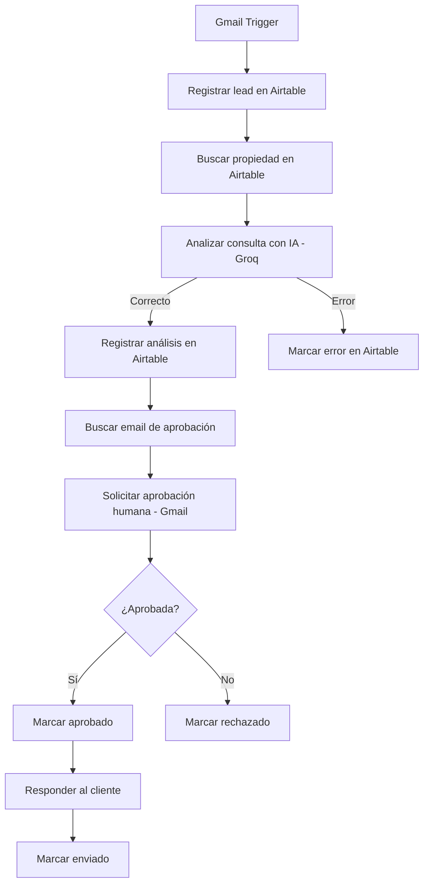

# 1. Arquitectura del sistema

## Objetivo

Automatizar la recepción y gestión de consultas inmobiliarias recibidas por Gmail, utilizando n8n como orquestador, Airtable como base de datos y Groq como proveedor del modelo de IA. Antes de responder al cliente, el sistema requiere aprobación humana (HITL).

## Diagrama de arquitectura

## Componentes y responsabilidades

| Componente | Función |
|---|---|
| Gmail Trigger | Recibe consultas y utiliza el filtro `in:inbox -from:me` para evitar bucles. |
| Airtable - Leads | Registra y actualiza cada consulta, su análisis y su estado. |
| Airtable - Propiedades | Proporciona precio, disponibilidad y código de la propiedad. |
| IA - Groq | Analiza la consulta y genera un JSON con prioridad, resumen, respuesta, código de propiedad y presupuesto. |
| Airtable - Configuración | Proporciona dinámicamente el correo del responsable de aprobación. |
| HITL - Gmail | Solicita aprobación humana antes de responder al cliente. |
| Ruta de error | Registra `Estado = Error` y `Detalle Error` sin continuar hacia el envío. |

## Rutas del workflow

**Camino aprobado:** el responsable aprueba la respuesta, se actualiza el estado del lead, se responde al cliente y se marca como enviado.

**Camino rechazado:** se registra el rechazo humano y no se envía ningún correo al cliente.

**Camino de error:** si falla el análisis de IA y no se recupera mediante los reintentos configurados, se registra el error técnico en Airtable y se detiene la ruta normal.

## Evidencia de ejecución

## Archivos técnicos

- [Workflow exportado de n8n](ENTREGA_8_Gestion_consultas_inmobiliaria_GitHub.json)
- [Documentación técnica completa](Entrega_Final_Automatizacion_Inmobiliaria_2026.pdf)
