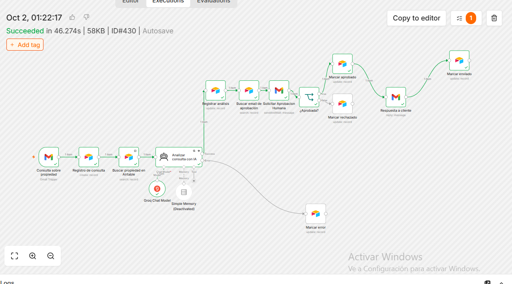
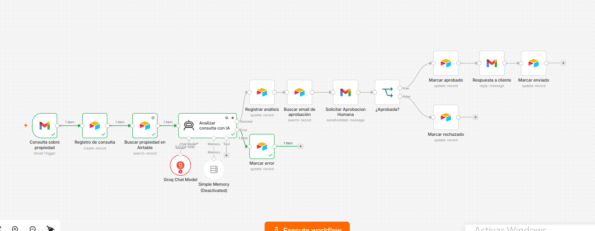

# 1. Arquitectura del sistema

## Descripción general

El proyecto automatiza la recepción y gestión de consultas inmobiliarias mediante n8n, Gmail, Airtable e inteligencia artificial.

n8n funciona como orquestador del proceso. Airtable registra las consultas y almacena la información de las propiedades, mientras que Groq ejecuta el modelo de IA encargado de analizar cada mensaje.

Antes de enviar una respuesta al cliente, el sistema incorpora una instancia obligatoria de aprobación humana (Human-in-the-Loop).

## Diagrama de arquitectura

```mermaid
flowchart TD
    A(("Gmail<br/>Trigger"))
    B["Registrar lead"]
    C["Buscar propiedad"]
    D["Analizar consulta"]
    E["Registrar análisis"]
    F["Marcar error"]
    G["Buscar aprobador"]
    H["Solicitar aprobación"]
    I{"¿Aprobada?"}
    J["Marcar aprobado"]
    K["Responder al cliente"]
    L["Marcar enviado"]
    M["Marcar rechazado"]

    A --> B
    B --> C
    C --> D

    D -->|Correcto| E
    D -->|Error| F

    E --> G
    G --> H
    H --> I

    I -->|Sí| J
    J --> K
    K --> L

    I -->|No| M

    classDef trigger fill:#E0E7FF,stroke:#6366F1,color:#1E1B4B,stroke-width:2px
    classDef proceso fill:#E0F2FE,stroke:#0284C7,color:#0C4A6E,stroke-width:1.5px
    classDef ia fill:#F3E8FF,stroke:#9333EA,color:#581C87,stroke-width:2px
    classDef humano fill:#FEF3C7,stroke:#D97706,color:#92400E,stroke-width:2px
    classDef decision fill:#FFEDD5,stroke:#EA580C,color:#9A3412,stroke-width:2px
    classDef exito fill:#DCFCE7,stroke:#16A34A,color:#166534,stroke-width:2px
    classDef rechazo fill:#FFE4E6,stroke:#E11D48,color:#9F1239,stroke-width:2px
    classDef error fill:#FEE2E2,stroke:#DC2626,color:#991B1B,stroke-width:2px

    class A trigger
    class B,C,E,G proceso
    class D ia
    class H humano
    class I decision
    class J,K,L exito
    class M rechazo
    class F error

    linkStyle 3 stroke:#16A34A,stroke-width:2px
    linkStyle 4 stroke:#DC2626,stroke-width:2px
    linkStyle 7 stroke:#D97706,stroke-width:2px
    linkStyle 9 stroke:#16A34A,stroke-width:2px
    linkStyle 12 stroke:#E11D48,stroke-width:2px
```

## Componentes y responsabilidades

| Componente | Función |
|---|---|
| Gmail Trigger | Detecta las nuevas consultas recibidas por correo electrónico. |
| Airtable - Leads | Registra los datos del cliente, la consulta y los estados del proceso. |
| Airtable - Propiedades | Permite buscar información comercial de la propiedad consultada. |
| IA - Groq | Analiza el mensaje, clasifica la prioridad, genera un resumen y propone una respuesta. |
| Airtable - Configuración | Almacena el correo electrónico del responsable de aprobar las respuestas. |
| HITL - Gmail | Solicita una aprobación humana antes de responder al cliente. |
| Ruta de error | Registra los errores técnicos producidos durante el análisis de IA. |

## Funcionamiento del workflow

### 1. Recepción de la consulta

El proceso comienza cuando el Gmail Trigger detecta un nuevo correo.

Se utiliza el filtro `in:inbox -from:me` para evitar que los correos enviados desde la propia cuenta vuelvan a activar la automatización.

### 2. Registro del lead

La información del correo se registra en la tabla Leads de Airtable.

Se almacenan datos como nombre, correo electrónico, asunto, mensaje y Thread ID de Gmail.

### 3. Búsqueda de la propiedad

El workflow consulta la tabla Propiedades de Airtable para obtener información sobre la propiedad mencionada por el cliente.

Entre los datos utilizados se encuentran el código de propiedad, precio y disponibilidad.

### 4. Análisis mediante inteligencia artificial

El modelo GPT-OSS Safeguard 20B, ejecutado mediante Groq, analiza la consulta y genera una respuesta estructurada en JSON.

La información generada incluye:

- Prioridad del lead.
- Resumen de la consulta.
- Respuesta propuesta para el cliente.
- Código de propiedad identificado.
- Presupuesto declarado, cuando corresponde.

### 5. Registro del análisis

Los resultados generados por la IA se guardan en Airtable y se actualiza el estado del lead.

### 6. Aprobación humana (HITL)

El workflow consulta la tabla Configuración de Airtable para obtener el correo del responsable de aprobación.

Posteriormente, envía la propuesta mediante Gmail y espera la decisión humana.

### 7. Decisión y respuesta

El workflow contempla dos caminos:

**Camino aprobado**

Si el responsable aprueba la propuesta:

1. Se actualiza el estado del lead a Aprobado por Humano.
2. Se envía la respuesta al cliente mediante Gmail.
3. Se actualiza el estado a Enviado.

**Camino rechazado**

Si el responsable rechaza la propuesta:

1. Se actualiza el estado del lead a Rechazado por Humano.
2. El workflow finaliza sin enviar una respuesta al cliente.

### 8. Ruta alternativa de error

Si el análisis mediante IA presenta una falla que no se resuelve con los reintentos configurados:

1. El workflow deriva la ejecución hacia la ruta de error.
2. Airtable actualiza el campo Estado a Error.
3. Se registra la información técnica en Detalle Error.
4. El proceso no continúa hacia la aprobación humana ni hacia el envío al cliente.

Esta ruta permite mantener un registro de los errores y evitar respuestas incorrectas.

---

## Evidencias del funcionamiento

### Workflow aprobado

La siguiente captura muestra una ejecución exitosa del workflow completo en n8n.



### Ruta de error

La siguiente captura muestra una prueba controlada de error y el recorrido alternativo del workflow.



---

## Archivos técnicos

- [Descargar workflow JSON de n8n](ENTREGA_8_Gestion_consultas_inmobiliaria_GitHub.json)
- [Consultar documentación técnica completa](Entrega_Final_Automatizacion_Inmobiliaria_2026.pdf)

